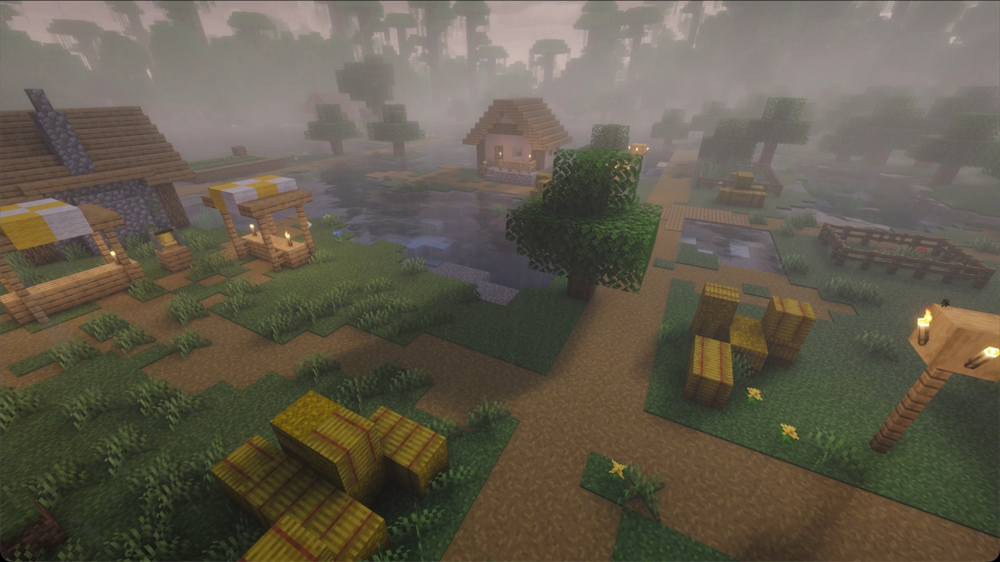
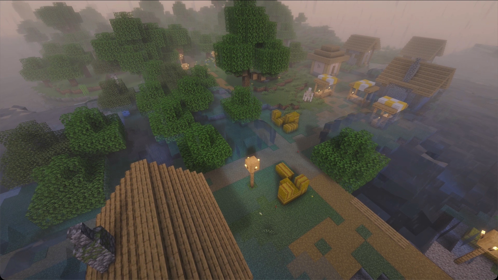
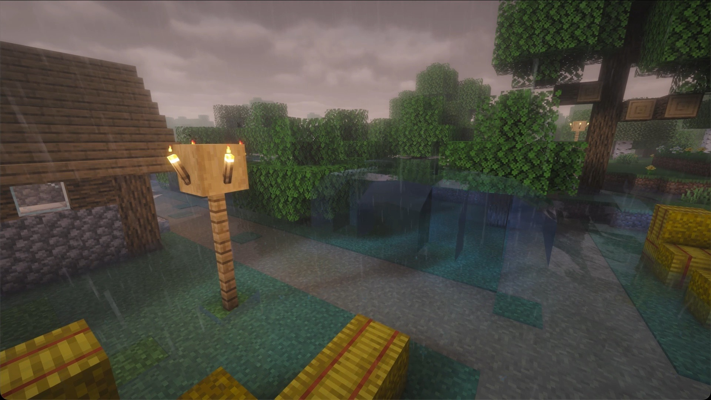
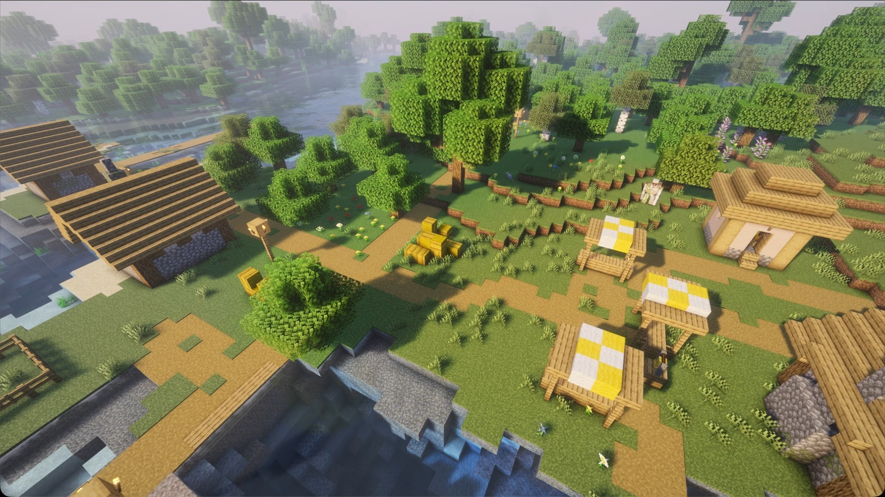

<div align="center">


**When the storm comes, the rivers rise.**

Heavy rain can turn into a flood: rivers, lakes and oceans overflow their banks,
spread across low ground, then drain away when the storm passes.

[](https://modrinth.com/mod/flash-flood)
[](https://www.curseforge.com/projects/1081223)


</div>

<p align="center">
  
  
</p>
<p align="center">
  
  
</p>

## How it works

- **Floods are a weather event.** Each time it starts raining there's a chance (25% by default) the rain turns into a flood.
- **Real water bodies overflow.** Rivers, lakes and (optionally) oceans rise above their normal level and spread outwards over low ground. Water only ever grows out of an existing body of water; nothing appears out of thin air.
- **The water keeps rising.** The flood starts at +1 block and climbs another block every 90 seconds, up to a configurable maximum (+2 by default).
- **It floods where it rains.** Only outdoors and in rainy biomes, never inside buildings or caves, not in deserts or snowy biomes, and never in unloaded chunks.
- **It drains naturally.** When the rain stops, the flood water turns back into flowing water and runs off, highest and outermost first, back into the river.
- **The land recovers.** Grass, flowers, ferns, tall grass and sugar cane covered or washed away by the flood grow back once the ground is dry. Player-built blocks are never removed.
- **Saved with the world.** Flood state and flood water are tracked per dimension, so a restart mid-flood never leaves permanent water behind.

While a flood is active (or draining), vanilla's infinite-water-source rule is paused so flowing flood water can't create new permanent sources. Your original setting is restored once the flood has fully drained.

## Commands

| Command | Description |
|---|---|
| `/flashflood start` | Start a flood in your dimension (starts rain if needed) |
| `/flashflood stop` | End the flood; the water drains away |
| `/flashflood status` | Show whether a flood is active, how high the water may rise, and how much flood water there is |

All commands need operator permission (level 2).

## Configuration

`config/flash_flood_config.json` is created on first launch. Values outside a sensible range are clamped.

| Option | Default | Description |
|---|---|---|
| `floodChance` | `0.25` | Chance (0 to 1) that a new spell of rain becomes a flood |
| `maxRise` | `2` | How many blocks above their normal level water bodies can rise |
| `riseIntervalSeconds` | `90` | Seconds between each extra block of rise (the first block is immediate) |
| `floodRadius` | `48` | Floods only spread within this many blocks of a player |
| `spreadAttemptsPerPlayer` | `48` | Spots checked around each player per tick; higher spreads faster |
| `maxBlocksPerTick` | `64` | Cap on flood water placed per dimension per tick |
| `drainBlocksPerTick` | `24` | Flood water drained per dimension per tick after the storm |
| `maxFloodBlocks` | `60000` | Safety cap on flood water per dimension |
| `floodOceans` | `true` | Allow oceans to overflow (rivers, lakes and ponds always can) |
| `replacePlants` | `true` | Let flood water cover plants instead of leaving dry spots; they grow back afterwards |
| `announceFloods` | `true` | Show an action-bar message when a flood starts and ends |

## Requirements

- Minecraft **1.21.1**
- **Fabric** (with [Fabric API](https://modrinth.com/mod/fabric-api)) or **NeoForge**
- [Architectury API](https://modrinth.com/mod/architectury-api) 13.0.8+

## Building

```sh
./gradlew build
```

Jars are written to `fabric/build/libs` and `neoforge/build/libs`.

<details>
<summary>Recording the trailer (development only)</summary>

`trailer/record-trailer.sh` launches a scripted Fabric dev client that creates a fixed-seed world, films a flood at a village by a river and records the game window with its audio (macOS, ScreenCaptureKit). It downloads Sodium, Iris and Complementary Unbound into the trailer's own run folder. None of this code ships in the release jars.

</details>

## Links

- [Modrinth](https://modrinth.com/mod/flash-flood)
- [CurseForge](https://www.curseforge.com/projects/1081223)
- [Issues](https://github.com/Bandit-bytes/flash_flood/issues)
